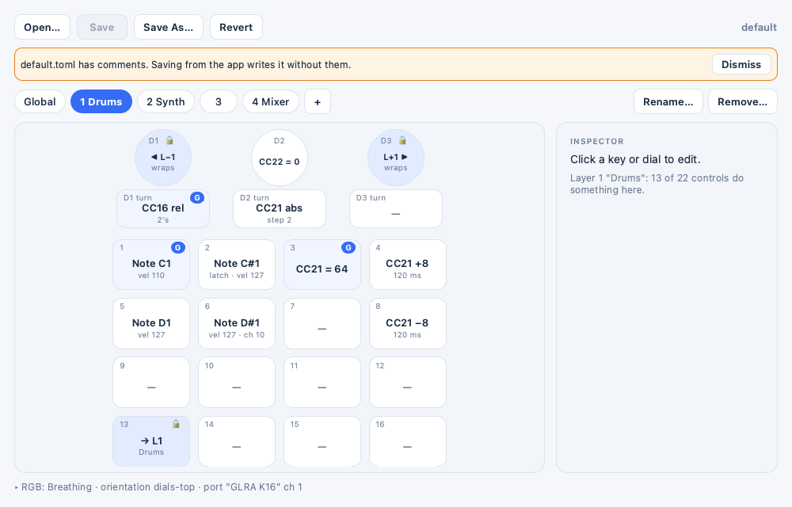
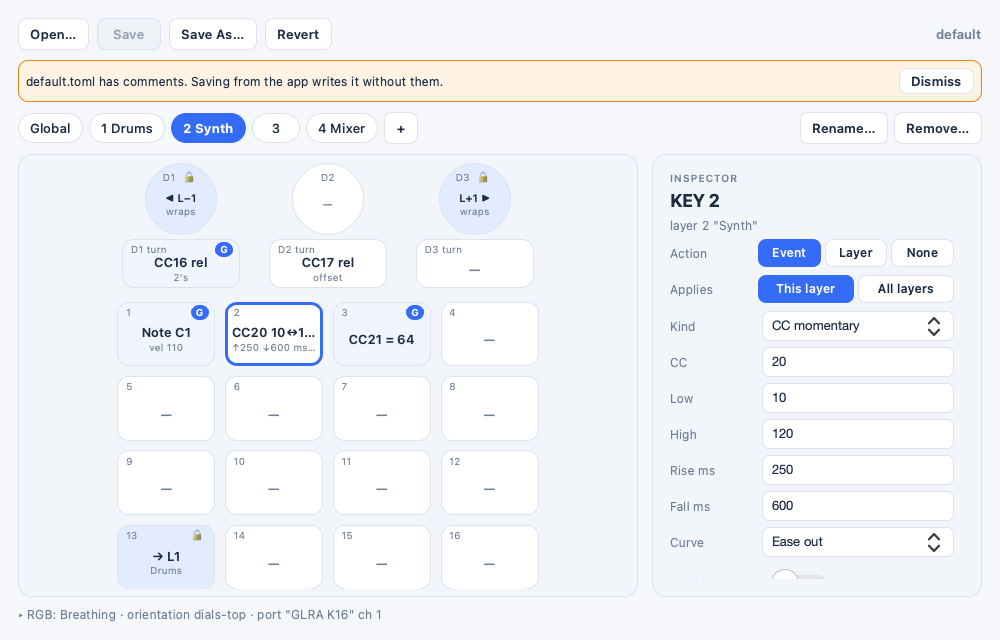
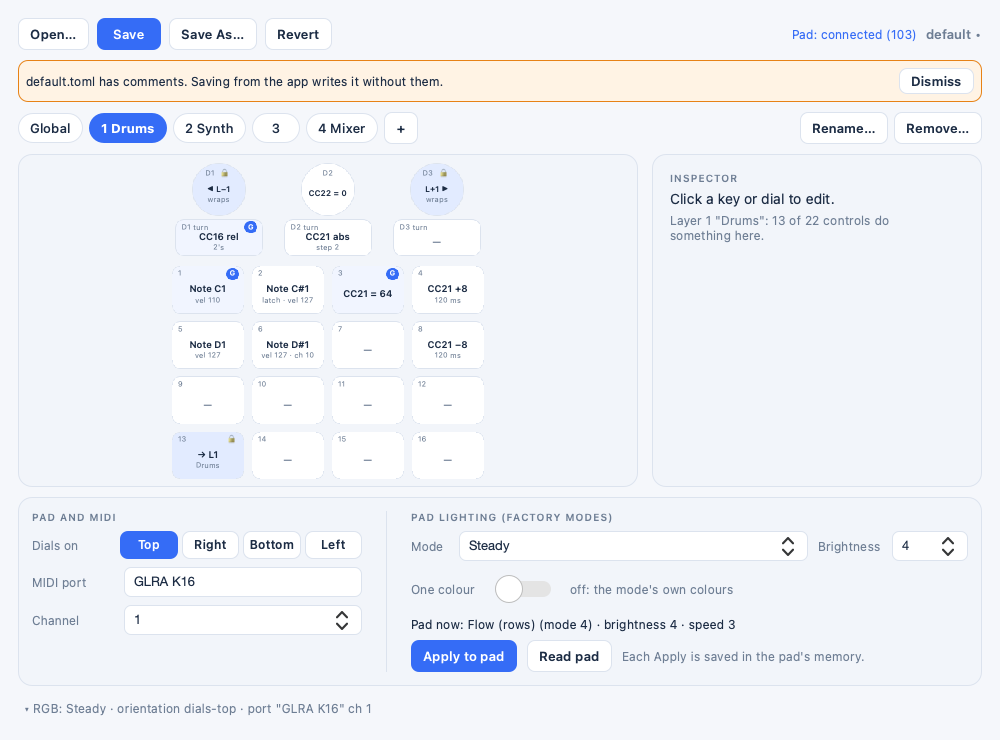

# glra-midi

Host-side middleware that turns the G-LRA K16_N3 macropad into a silent MIDI
controller (OSC later). It builds on [glra-studio](https://github.com/imolitor/glra-studio)
for device I/O.

**Status:** pre-alpha, but working. As of 2026-11-13 `glra-midi run` plays a profile (layers, per-layer channels, notes, CCs with glides) on a virtual MIDI port and silences the pad so it doesn't type into apps, and `glra-midi config` is an app that edits those profiles and picks the pad's factory RGB mode and orientation. Bob tried the app on 2026-11-13 and judged it "working well enough for a first release". macOS only. OSC output doesn't exist yet. Planned work lives on the loom (`.loom/`).

## Install and run

Needs macOS and Python 3.13 or later (Homebrew's `python3.14` works).

```sh
git clone https://github.com/zealtv/glra-midi.git
cd glra-midi
python3 -m venv .venv
.venv/bin/pip install -e '.[gui]'     # gui adds PySide6 for the configuration app
```

Then, with the pad plugged in:

1. **Configure:** `.venv/bin/glra-midi config` opens the configuration app on your current
   profile (the first start creates one from the shipped default: three layers, keys as
   notes 36-51, the dial pushes pick the layer). Try `--demo` first if you'd like a fake pad
   and a throwaway profile.
2. **Play:** `.venv/bin/glra-midi run` sends MIDI on a virtual port named **GLRA K16**. Pick
   that port as a MIDI input in your DAW or synth. The pad stops typing while `run` runs.
   Edits you save in the app reach a running `run` within half a second.
3. **Stop** `run` with Ctrl-C. If the pad still types nothing afterwards (say after a
   `kill -9`), run `.venv/bin/glra-midi unsilence` or replug it.

To skip the `.venv/bin/` prefix, `source .venv/bin/activate` first.

## Usage

macOS only. Install into a virtualenv (see "Setup and tests" below; call `.venv/bin/glra-midi` or activate it), then:

```sh
glra-midi config               # the configuration app (needs the gui extra: pip install -e '.[gui]')
glra-midi config --demo        # the app on a throwaway profile folder and a fake pad
glra-midi run                  # play the current profile on the virtual MIDI port "GLRA K16"
glra-midi run --dry-run        # print pad events, layer changes and MIDI instead of sending it
glra-midi run --config my.toml # play this profile file instead
glra-midi monitor              # read-only live view of decoded control events
glra-midi monitor --raw        # ...plus each raw report as hex
glra-midi monitor --profile p.toml  # number events as displayed in the profile's [pad] orientation
glra-midi unsilence            # remove glra-midi's key-mapping entries from the pad
```

- **The configuration app.** `glra-midi config` (or `glra-midi-config`) edits the current profile: layer tabs (Global, 1..n), the pad drawn in its orientation, an inspector for the selected key or dial, and a device panel for orientation, port, channel and the factory RGB mode. Lighting reaches the pad only when you press **Apply to pad**; each Apply is saved in the pad's flash. Design: `docs/config-app.md` §4.

  
  
  

- **Profile.** `run` plays a profile: a TOML file (`version = 1`) that says what each key,
  dial push and dial turn does, per layer or on every layer. Without `--config` it plays the
  profile named in `~/Library/Application Support/glra-midi/current`, from the `profiles/`
  folder beside it; the first run creates `profiles/default.toml` from the shipped
  `glra_midi/default_profile.toml`, which documents every field. A profile folder left by
  glra-osc (this project's name until 2026-11-13) at `~/Library/Application Support/glra-osc/`
  is moved to `glra-midi/` the first time a `glra-midi` command or the app runs, if
  `glra-midi/` doesn't exist yet; it says so once. Old mapping files no longer
  load (Bob, 2026-11-13: "we can hard break"); `--config` takes profiles only. The format and
  the engine's rules are in `docs/config-app.md` (sections 2 and 3).
- **Layers.** A profile has 1 to 8 layers (the shipped default has 3). A control can hold one event for every
  layer, an event (or nothing) on each layer separately, or a layer key (`layer-set`,
  `layer-inc`, `layer-dec`). `run` starts on layer 1; a layer change sends no MIDI, and
  `--dry-run` prints it (`# layer 1 -> 2 'Synth'`). A key released after a layer change still
  ends what its press started.
- **Events.** `note` (momentary or latch), `cc-momentary` (low and high value, separate
  `rise-ms` and `fall-ms`, an easing curve, momentary or latch), `cc-set`, `cc-step` (a signed
  step, with `ease-ms` and a curve), and for dial turns `cc-relative` and `cc-absolute`. A time
  above 0 makes the CC glide there in 10 ms steps (100 Hz) while it moves; the run loop idles
  when nothing glides. `--dry-run` prints each value the glide sends.
- **Hot reload.** `run` checks every 0.5 s whether the profile file changed (the app saves by
  rename) or `current` now names another profile, and reloads it: held notes get their Note
  Off, running glides jump to their targets or `low`, the engine restarts, and the active
  layer stays if the new profile still has it, else it returns to layer 1. A file that
  doesn't validate leaves the old profile playing and prints the error once. A changed
  `[midi] port` needs a restart of `run`. With `--config` only that file is watched.
- **Orientation.** A profile's `[pad] orientation` (`dials-top`, `dials-right`, `dials-bottom`,
  `dials-left`) sets how controls are numbered and drawn; the file itself keeps physical names
  (`key.13`), so turning the pad remaps nothing. `monitor --profile` prints `KEY 01 [key.13] DOWN`
  (displayed number, physical id in brackets); `run --dry-run` labels the pad events it prints the
  same way, from the playing profile. Clockwise stays clockwise. The firmware's lighting
  animations run in the vendor's frame (dials on the right) whatever orientation you choose.
  Directions get confirmed at the pad on the config-app tour (design: `docs/config-app.md` §6).
- **Silencing.** While `run` or `monitor` runs, it maps the pad's codes to "no event" with
  `hidutil`, so the pad stays quiet for the system and only glra-midi hears it. Your own
  entries on the pad (for example a CapsLock remap) stay. On exit (Ctrl-C or SIGTERM) it
  removes only its own entries. After `kill -9` the entries stay until you replug the pad
  or run `glra-midi unsilence`. If the pad can't be silenced, `run` and `monitor` refuse to
  start; `--allow-typing` starts them anyway, and the pad then types into the focused app.
- **Known gap: the first ~3 s after a (re)plug.** For about 3 s after the pad connects, macOS
  puts its own key mapping back whenever glra-midi sets one (observed 2026-11-12, macOS 14.6).
  glra-midi re-checks every 100 ms and repairs it, but a key pressed in one of those short gaps
  can still type into the focused app. Wait a few seconds after plugging the pad in before
  playing.
- Stop with Ctrl-C.

## Setup and tests

Needs Python 3.13+ on macOS (Homebrew's `python3.14` works).

```sh
/opt/homebrew/bin/python3.14 -m venv .venv
.venv/bin/pip install -e '.[dev,gui]'   # gui: PySide6, for the configuration app
./test.sh          # ruff + unittest (the app tests skip without the gui extra)
.venv/bin/glra-midi --version
```

`tools/app-capture.sh <state> <out.png>` renders a named state of the app offscreen.

## Releases

Versions follow SemVer (0.x: a minor bump may break the profile format or the command line);
releases go out as GitHub releases only, with a wheel and an sdist attached. What changed is in
[`CHANGELOG.md`](CHANGELOG.md); how a release gets cut and checked is in
[`docs/releasing.md`](docs/releasing.md) (`tools/release-check.sh <version>`).

## Help wanted

We're looking for information on the pad's microcontroller (marked `SDC32K 952CCU6`;
catalogued, we think, as the Masses Chip `M9F9520`): a datasheet, pinout, programming
interface, or whether the flash can be read back. If you know anything, or an AI agent
you work with does, see [`docs/wanted-m9f9520.md`](docs/wanted-m9f9520.md) for what we
know and how to answer (a GitHub issue labelled `chip-info`).

## Licence

GPL-3.0-only, because it reuses glra-studio code. See `LICENSE` and
`THIRD_PARTY_NOTICES.md`.
